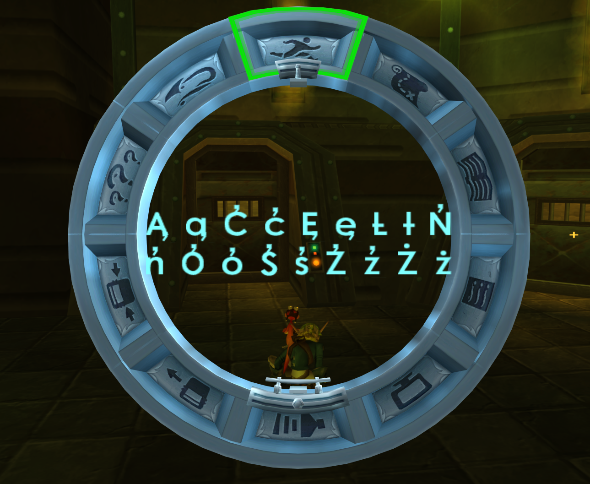
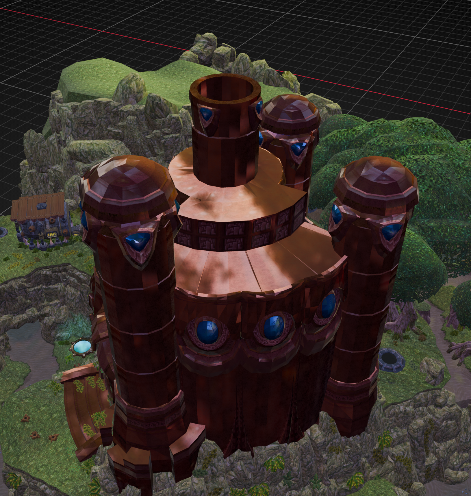
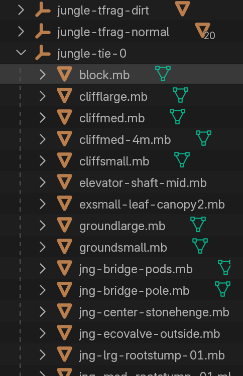
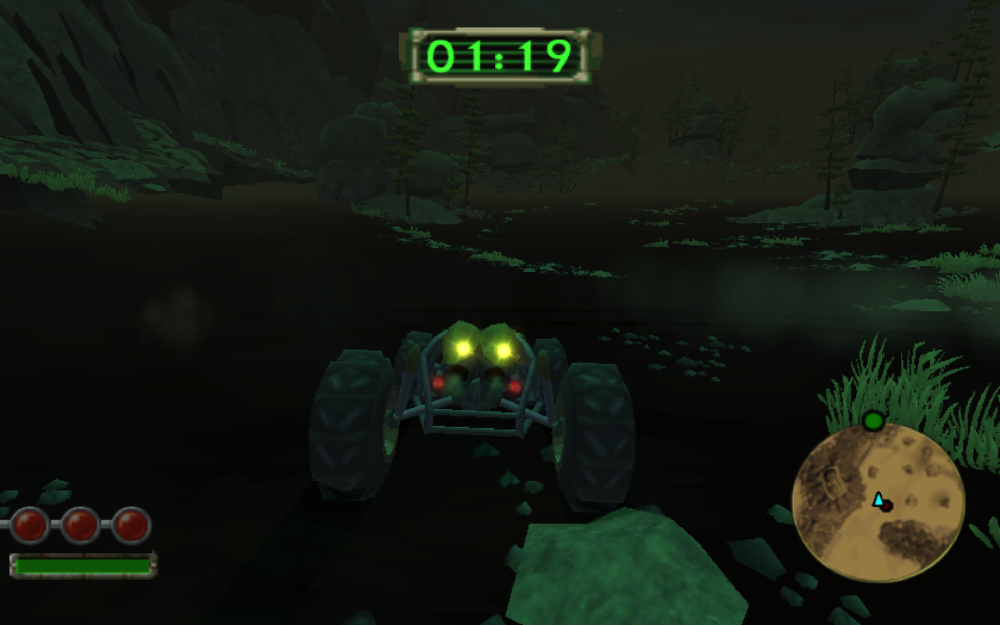
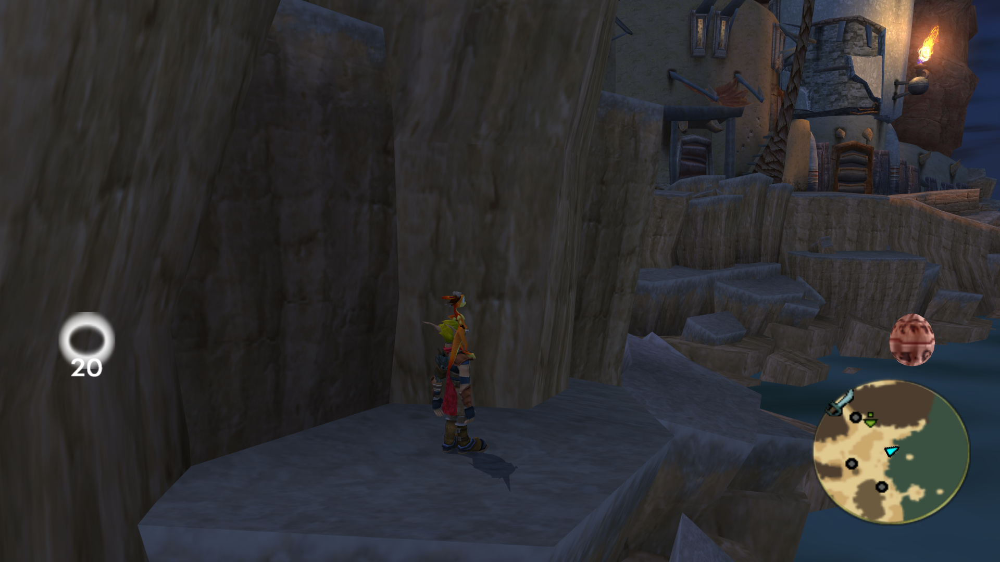
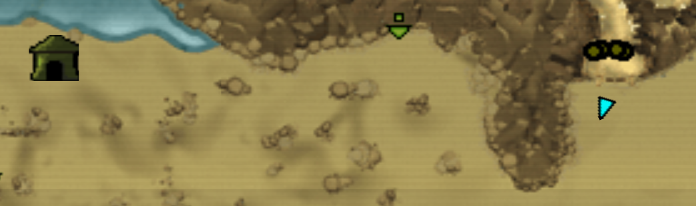

<head>
  <meta name="twitter:card" content="summary_large_image" />
</head>

New extractor features, and several bugs fixed - most of them from OpenGOAL, but a couple from Naughty Dog.

<!--truncate-->

## Release Info

This month's OpenGOAL Tooling (`jak-project` repo) release is `0.3.8`. <!-- TODO cut new version to pickup all the changes mentioned? (some not yet merged) -->

<div className="row markdownMarginBottom">
  <div className="col col--12">
    <LauncherDownloadLink />
  </div>
</div>

<!-- ## Community Spotlight

:::info
If you want to play this mod (and others), follow the instructions [here](https://jakmods.dev/) to set up a mod list for the OpenGOAL launcher.
::: -->

<!-- ## Known Issues -->

## Launcher

### Restore external links on mod pages <PRLink href="https://github.com/open-goal/launcher/pull/1023"/>

Added back the icon to jump to a mod's website/README.

### Add swap space metric to support package <PRLink href="https://github.com/open-goal/launcher/pull/1072"/>

Some Linux users have reported `Decompiler process terminated by signal 9`, which can result from the decompiler using all the RAM and swap space. Allocating more swap space results in the decompiler finishing successfully. This change added information to the support package to help identify this issue.

### Hide (vanilla) tooling update icon while on mod page <PRLink href="https://github.com/open-goal/launcher/pull/1032"/>

The launcher header shows either the currently installed version of the vanilla tooling, or the version of a particuar mod if you're on the mod's page. There is also an icon that appears in the header when there's a vanilla tooling update, but it was still showing from mod pages, causing confusion. Now it only shows while the vanilla tooling version is shown.

## General Changes

### Translations <PRLink href="https://github.com/open-goal/jak-project/pull/4349"/> <PRLink href="https://github.com/open-goal/jak-project/pull/4352"/> <PRLink href="https://github.com/open-goal/jak-project/pull/4332"/> <PRLink href="https://github.com/open-goal/jak-project/pull/4431"/> <PRLink href="https://github.com/open-goal/jak-project/pull/4350"/> <PRLink href="https://github.com/open-goal/jak-project/pull/4381"/> <PRLink href="https://github.com/open-goal/jak-project/pull/4358"/> <PRLink href="https://github.com/open-goal/jak-project/pull/4363"/> 

All translations from [Crowdin](https://crowdin.com/project/opengoal) should now be updated and added to the games. This includes changes for Catalan, Galician, Polish, Portuguese, Finnish, Czech, German, Spanish, Croatian, Italian, Lithuanian, Dutch, Portuguese (Brazilian), Romanian! We also improved some behavior in how translated subtitles are handled in Jak 2 and 3.

If you're interested in contributing translations, check out [these guides](https://opengoal.dev/docs/category/contributing).

Special thanks to `rafalekkB` for fixing up the glyphs for Polish, as well as fixing some broken filepaths copy-pasted from Jak 2 to Jak 3!



### Add VSCode debug adapter support <PRLink href="https://github.com/open-goal/jak-project/pull/4365"/> <PRLink href="https://github.com/open-goal/opengoal-vscode/pull/375"/>

Added a debug server to goalc that sends JSON over the socket to communicate with an external debugger using the Debug Adapter Protocol. This lets us debug GOAL code in a proper debugger with breakpoints, step over, step in and step out per line, stack frames and supports watches for global symbols, registers and local variables (local variables only work within the most recent stack frame).

Watches that track addresses holding a reference type generate a list of field names according to the object's type. All fields will show their name, type and value and, depending on the type, will try to infer extra info like symbol names/values, function names for function fields, enum values and more.

### Support time-of-day colors in custom levels <PRLink href="https://github.com/open-goal/jak-project/pull/4111"/>

Added support for storing different colors for changing time-of-day in custom level meshes.

<ReactPlayer
  controls
    src={require("./video/time_of_day.mp4").default}
/>

### Various GLTF exporter fixes <PRLink href="https://github.com/open-goal/jak-project/pull/4371"/>

- Merc and TIE envmaps now properly extract
- Changed joint offset in convert_per_vertex_data since we now export the align bone
- The bone accessor for merc models now uses TINYGLTF_COMPONENT_TYPE_UNSIGNED_BYTE, fixing a decompiler crash when attempting to reimport an extracted model into the game without first importing it into Blender and re-exporting
- All model buffers now get merged into one large buffer before export, saving some space and increasing parsing speed of GLB files
- Tfrags, TIEs and shrubs are now no longer stored in one giant mesh per tree and get grouped into categories:
  - Tfrags will be grouped by the tfrag tree name they come from (normal, trans, dirt, ice, etc.) and get separated by the texture their material uses (tfrags are not instanced, so this is the next best solution)
  - TIEs and shrubs get grouped by tree index and separated by their proto name (TIE wind will also be grouped separately)





### Sound Effect & Music Extraction <PRLink href="https://github.com/open-goal/jak-project/pull/4401"/> <PRLink href="https://github.com/open-goal/launcher/pull/1038"/>

Added the ability to extract sound effects to `.wav` files for each of the four games, and music to `.wav` files for Jak 1 and Jak 2. <!-- TODO not merged --> There's a corresponding new decompiler option in the launcher settings for extracting music.

### Fixed custom level region crash on Windows <PRLink href="https://github.com/open-goal/jak-project/pull/4369"/>

On Windows, the pairs produced by custom regions (Jak 2 & 3) all become bogus, probably due to some compiler differences. Changing the pairs that get stored in the regions to not be pointers should avoid a potential use-after-free bug.

### Fixed menu text boundaries and alignments across aspect ratios <PRLink href="https://github.com/open-goal/jak-project/pull/4380"/>

Fixed the alignment of text and other elements in several menus of Jak 3 (as well as some of Jak 2) when using Automatic or Custom aspect ratios.

### Fixed cloud mipmap issue <PRLink href="https://github.com/open-goal/jak-project/pull/4344"/>

Fixed an oversight in `TextureAnimator::run_clouds` where it would read a texture that is attached to the bound framebuffer.

### Fixed bug ignoring texture replacements for `merc` and `shrub` <PRLink href="https://github.com/open-goal/jak-project/pull/4405"/>

Fixed a regression from decompiler optimization, where some texture replacements wouldn't be processed properly.

### Limit decompiler threads by hardware concurrency <PRLink href="https://github.com/open-goal/jak-project/pull/4417"/>

Fixed a regression from decompiler optimization, restoring the previous behavior prior and preventing the level extraction process from creating too many threads.

### Retail reboot from imgui menu <PRLink href="https://github.com/open-goal/jak-project/pull/4404"/>

Added an option to the imgui menu `Reboot in Retail Mode`, similar to the existing `Reboot in Debug Mode`.

### ARM64 improvements and Apple Silicon support <PRLink href="https://github.com/open-goal/jak-project/pull/4377"/> <PRLink href="https://github.com/open-goal/jak-project/pull/4384"/> <PRLink href="https://github.com/open-goal/jak-project/pull/4385"/> <PRLink href="https://github.com/open-goal/jak-project/pull/4386"/> <PRLink href="https://github.com/open-goal/jak-project/pull/4390"/> <PRLink href="https://github.com/open-goal/jak-project/pull/4419"/> <PRLink href="https://github.com/open-goal/jak-project/pull/4420"/>

Various fixes for ARM64 compilation, and support for building and running the game natively on Apple Silicon.

### Misc CI/build fixes <PRLink href="https://github.com/open-goal/jak-project/pull/4396"/> <PRLink href="https://github.com/open-goal/jak-project/pull/4410"/> <PRLink href="https://github.com/open-goal/jak-project/pull/4411"/> <PRLink href="https://github.com/open-goal/jak-project/pull/4355"/> <PRLink href="https://github.com/open-goal/jak-project/pull/4379"/> <PRLink href="https://github.com/open-goal/jak-project/pull/4393"/> <PRLink href="https://github.com/open-goal/jak-project/pull/4392"/> <PRLink href="https://github.com/open-goal/jak-project/pull/4394"/>

Various fixes to the build process.

## Jak X <!-- TODO do we wanna keep this --> 

### VU program disassembly <PRLink href="https://github.com/open-goal/jak-project/pull/4406"/>

All VU programs are unchanged from Jak 3 except:
- `sparks-vu1` NEW
- `ocean-near-vu1` DIFFERENT
- `sprite-glow-vu1` DIFFERENT
- `tnear-vu1` DIFFERENT
- `hfrag` REMOVED
- `ocean` REMOVED
- `ocean-texture` REMOVED

### More decompilation (`collide`, `debug`, `drawable`, `net`, `vehicle`, etc) <PRLink href="https://github.com/open-goal/jak-project/pull/4360"/>

Breaks the 300 file milestone, also includes the majority of mips2c functions carried forward from Jak 3.

## Jak 3

### Fixed `def-actor` macro <PRLink href="https://github.com/open-goal/jak-project/pull/4342"/>

Corrected the art group version number (8) used for the Jak 3 `def-actor` macro for custom actors. It was originally copied over from Jak 2 and still using that art group version number (7).

### Fixed missing `hfrag` desert textures on macOS <PRLink href="https://github.com/open-goal/jak-project/pull/4353"/>

Removed unused vertex attribute that macOS's OpenGL driver seems to dislike.



### Fixed mirror world HUD alignment <PRLink href="https://github.com/open-goal/jak-project/pull/4373"/>

Mirror world has a custom implementation in OpenGOAL, and some vanilla code that was meant to be disabled was duplicating the mirror work for certain HUD elements.



### Fixed Onin's tent minimap icon showing in the desert <PRLink href="https://github.com/open-goal/jak-project/pull/4435"/>

<!-- TODO not merged yet --> 
Fixed an original game bug where the minimap icon for Onin's tent would show up in the desert in the northwest, rather than showing the blue air train icon in the northeast. This icon was missing some of the flags that other Haven City icons have that tell the game to show the air train icon instead of the real icon while outside of Haven City.



### Improved `game-score` related decomp, extended speedrun autosplitter to track ranked side missions and orbs by level <PRLink href="https://github.com/open-goal/jak-project/pull/4398"/> <PRLink href="https://github.com/open-goal/jak-project/pull/4409"/> <PRLink href="https://github.com/open-goal/speedrunning/pull/35"/>

Jak 3 has leftover, unused `money-per-level` fields in `game-info` carried over from Jak 1 - so we repurposed these fields to actually track orbs collected by level. The speedrun autosplitter was extended to track orbs by level.

We also extended the autosplitter to track bronze/silver/gold rankings for side missions. As part of this, we filled out the `game-score` enum and cleaned up the decompilation of related code.

```diff
-    (set! (-> self game-score) (the-as uint 2))
+    (set! (-> self game-score) (game-score turtle-race))
-    (let ((v1-6 (game-info-method-29 *game-info* (the-as int (-> self game-score))))
+    (let ((v1-6 (get-best-rank *game-info* (-> self game-score)))
```

### Extended secret selection and categories in speedrun menu <PRLink href="https://github.com/open-goal/jak-project/pull/4397"/> <PRLink href="https://github.com/open-goal/jak-project/pull/4425"/>

Extended the speedrun menu to allow secret selection separately for Act 2, Act 3, Post-Game, and Hero Mode categories. Also added Hero Mode Act 2 and 3 categories.

## Jak 2

### Fixed broken language changing <PRLink href="https://github.com/open-goal/jak-project/pull/4418"/>

Fixed a bug which would cause a language change from the progress menu to be ignored.

## Jak 1

### Patched debug crash in subtitle code <PRLink href="https://github.com/open-goal/jak-project/pull/4348"/>

Fixed a crash in subtitle code that only runs in debug mode, and tries to log information about any currently playing cutscene. The code was checking the handle `(-> *art-control* spool-lock)` rather than the process `(handle->process (-> *art-control* spool-lock))` to decide whether or not to log. While the handle may not be `#f`, this might still not resolve to a valid process, in which case the game crashes trying to log the cutscene information.

### Patched autosave/progress locked menu <PRLink href="https://github.com/open-goal/jak-project/pull/4340"/>

There's an original game bug where under the right conditions, you can get stuck on a blank pause menu screen permanently, and have no choice but to reboot the game.

The first time you collect a cell after saving to a new file, the game will show a popup telling you about the autosave feature. If you collect such a cell during a pause buffer (the brief window after pressing Start and L2/R2 on same frame), the game gets stuck waiting on conditions that will never change. 

The pause menu is waiting on the autosave to finish, but the autosave is stuck waiting on the cell cutscene to play, and the cell cutscene is stuck waiting to play because the pause menu has come up. The game is actually still running, it just has no way to get unblocked and ignores any player input (its unblocked by running code in the REPL in the video below).

<ReactPlayer
  controls
  src={"https://www.youtube.com/watch?v=4eZlQbRq6l8"}
  className="blog-video"
/>

This isn't a bug most players would run into, but it does affect speedrunners in certain situations. So we opted to fix this bug only while speedrun mode was enabled. In speedrun mode we were already skipping the autosave popup, but not until after the code that loops until there's no pending cutscene was satisfied. We changed the order of these checks, so that we wouldn't bother with the cutscene check if we were in speedrun mode.

### Restored NaN check in nav code <PRLink href="https://github.com/open-goal/jak-project/pull/4359"/>

Added back a NaN check in some common nav code which was inadvertently removed during decompiler cleanup. This was causing enemies to suddenly disappear in certain situations.